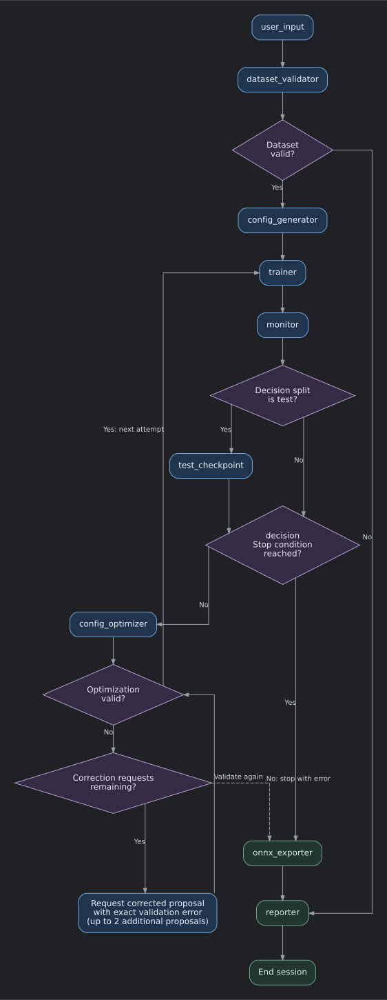

# Classification Training Agent and Pipeline Documentation

## Contents

- [Classification Training Agent and Pipeline Documentation](#classification-training-agent-and-pipeline-documentation)
  - [Contents](#contents)
  - [1. Purpose and terminology](#1-purpose-and-terminology)
  - [2. Workflow](#2-workflow)
  - [3. Configuration and precedence](#3-configuration-and-precedence)
    - [3.1 Current YAML defaults](#31-current-yaml-defaults)
    - [3.2 Hosted LLM configuration](#32-hosted-llm-configuration)
  - [4. Pipeline stages](#4-pipeline-stages)
  - [5. What the LLM sees and can change](#5-what-the-llm-sees-and-can-change)
    - [5.1 LLM stages](#51-llm-stages)
    - [5.2 Prompt compaction](#52-prompt-compaction)
    - [5.3 Allowed changes](#53-allowed-changes)
  - [6. Stopping rules and limits](#6-stopping-rules-and-limits)
  - [7. Memory and historical evidence](#7-memory-and-historical-evidence)
  - [8. Interruptions, standalone evaluation, and resume](#8-interruptions-standalone-evaluation-and-resume)
    - [Evaluating an existing checkpoint](#evaluating-an-existing-checkpoint)
    - [Resuming the standalone trainer](#resuming-the-standalone-trainer)
  - [9. Code reference](#9-code-reference)

## 1. Purpose and terminology

The agent manages training for single-head and multi-head image classifiers. It measures results, asks a hosted LLM to interpret those results and propose supported configuration changes, and repeats training until a stopping condition is reached. PyTorch performs training and inference locally. LangGraph coordinates the stages. The hosted LLM supplies analysis and configuration proposals.

The workflow separates experiment management from the underlying classifier architecture. ResNet is the example implementation described here. Other architectures can use the same workflow once compatible training, checkpoint loading, evaluation, and export implementations are integrated; selecting an arbitrary architecture name alone does not add support.

| Term | Meaning in this project |
|---|---|
| Backbone | The model's feature extractor, shared across heads in a multi-head classifier. The ResNet example uses `resnet18`, `resnet34`, or `resnet50`. |
| Head | A prediction branch for one CSV label column, such as `make`. The ResNet example uses a linear classifier for each head. |
| Epoch | One traversal of the training loader, followed by validation, within a single experiment. |
| Attempt / experiment | One training run with a selected architecture, initialization weights when required, and configuration. |
| Session | One agent invocation containing its sequence of experiments. |
| Checkpoint | A saved PyTorch model and its metadata. |
| Decision split | The split whose measured accuracy controls the target gate and best-experiment selection: `test` or `val`. |
| Target metric | `mean_acc` or one requested head's accuracy, such as `make_acc`. |
| LLM retry | Another API request for the same analysis after a temporary rate limit; it does not create an experiment. |
| Optimization correction | Another proposal requested with the exact error from invalid optimizer output; it does not create an experiment. |

## 2. Workflow



## 3. Configuration and precedence

### 3.1 Current YAML defaults

| Setting | Meaning |
|---|---|
| `decision_split` | `test` or `val`; controls the experiment score used for decisions. |
| `target_metric` | Mean head accuracy or a requested head's accuracy. |
| `target_value` | Accuracy fraction in `[0, 1]`; `0.99` means 99%. |
| `max_attempts` | Maximum total training experiments in one session. |
| `export_format` | `onnx` or `none`. |
| `nproc_per_node` | Number of CUDA/DDP training processes. |
| `epochs` | Maximum epochs for the baseline experiment. |
| `batch_size` | Training batch size per GPU. |
| `num_workers` | DataLoader workers per GPU. |
| `img_size` | Fixed resize dimensions `[height, width]`. |
| `lr`, `weight_decay` | AdamW learning rate and weight decay. |
| `gamma` | Focal-loss focusing exponent. |
| `patience` | Consecutive epochs without improved monitored validation accuracy before early stopping. |

### 3.2 Hosted LLM configuration

Copy [`.env.example`](../.env.example) to `.env` and set your API key. The template matches the client defaults:

```ini
OPENAI_API_KEY=replace_with_your_api_key
OPENAI_MODEL=gpt-4o
LLM_TEMPERATURE=0.1
LLM_MAX_TOKENS=512
LLM_TIMEOUT_SECONDS=30
LLM_MAX_RETRIES=2
LLM_RATE_LIMIT_MAX_WAIT_SECONDS=60
LLM_OPTIMIZATION_MAX_HYPERPARAMETERS=1
LLM_CONTEXT_HISTORY_ENTRIES=5
LLM_CONTEXT_RECENT_EXPERIMENTS=3
LLM_CONTEXT_MAX_ITEMS=3
LLM_CONTEXT_MAX_CLASSES_PER_HEAD=50
```

| Variable | Code default if unset | Meaning |
|---|---|---|
| `OPENAI_MODEL` | `gpt-4o` | Model passed to the chat client; `.env.example` uses the same default. |
| `LLM_TEMPERATURE` | `0.1` | Sampling temperature. |
| `LLM_MAX_TOKENS` | `512` | Positive output-token cap for each request. It does not cap input prompt tokens. |
| `LLM_TIMEOUT_SECONDS` | `30` | Positive finite timeout configured on the client. |
| `LLM_MAX_RETRIES` | `2` | Additional requests allowed after transient HTTP 429 errors; zero disables them. |
| `LLM_RATE_LIMIT_MAX_WAIT_SECONDS` | `60` | Positive finite cumulative planned sleep budget for one LLM invocation. |
| `LLM_OPTIMIZATION_MAX_HYPERPARAMETERS` | `1` | Positive integer: maximum supported hyperparameter keys whose values can change in one optimizer proposal. |
| `LLM_CONTEXT_HISTORY_ENTRIES` | `5` | Positive integer: most recent entries retained from each loss or accuracy history. |
| `LLM_CONTEXT_RECENT_EXPERIMENTS` | `3` | Positive integer: most recent current-session experiments retained, plus an older best verified experiment when needed. |
| `LLM_CONTEXT_MAX_ITEMS` | `3` | Positive integer: maximum items in each historical issues or recommendations list. |
| `LLM_CONTEXT_MAX_CLASSES_PER_HEAD` | `50` | Positive integer: maximum tested class results retained per head, prioritizing lowest accuracy. |

## 4. Pipeline stages

| Stage | Input and work | Main state/output updates |
|---|---|---|
| `user_input` | Resolve CLI, environment, YAML defaults, aliases, and optional prompts. | Split paths, heads, model selection, target, limit, loss inputs, input errors. |
| `dataset_validator` | Check inputs, CSVs, image paths, labels, and class mappings. | `validation_report`, normalized paths, `is_valid`. |
| `config_generator` | Build first configuration from YAML plus resolved inputs; allocate the session. | `current_config`, `session_dir`, initial config history and Markdown summary. |
| `trainer` | Validate full configuration and CUDA/NCCL availability; launch torchrun. | Incremented `attempt_number`, `training_result`, run folder, checkpoints. |
| `monitor` | Read training metric CSV; recover checkpoint-aligned validation results and histories. | `metrics` or a failure status. |
| `test_checkpoint` | In test mode, infer on all test rows using the best validation checkpoint. | Primary test metrics, separate validation snapshot, `test_result`. |
| `evaluator` | Ask LLM for diagnosis when usable results exist; apply deterministic corrections and target checks. | `evaluation_result`, issues, `target_reached`. |
| `memory` | Save experiment, verified score, completed comparisons, and session overview. | Experiment history, `best_experiment`, knowledge base, experiment JSON. |
| `decision` | Evaluate required test evidence, target, attempt limit, and instability. | `stop_reason`, confirmed target result. |
| `config_optimizer` | Request and validate a proposal; request up to two corrections with exact errors for invalid output. | Accepted next configuration and rationale, or terminal optimization error. |
| `onnx_exporter` | Export the session's eligible best checkpoint when requested. | ONNX path and metadata, or an export error. |
| `reporter` | Build factual reports and optionally append an LLM narrative. | Markdown report, report JSON, updated session summary. |

## 5. What the LLM sees and can change

### 5.1 LLM stages

| LLM use | Receives | Returns |
|---|---|---|
| Evaluation | Current measured metrics, configuration, decision split, target, and validation diagnostics. | Verdict, target proposal, issues, recommendations, reasoning. |
| Optimization | Current configuration/results, evaluation, compatible pretrained model catalog, compact current-session experiment history, `current_class_alpha`, and training `classes_by_head`; correction requests also include rejected output and its exact validation error. | `updated_config` and a brief `rationale`. |
| Final narrative | Session facts, best result/configuration, comparison rows, artifact paths, and errors. | Optional Markdown analysis appended to the factual report. |

### 5.2 Prompt compaction

[agent/llm_context.py](../agent/llm_context.py) keeps:

- Scalar metric values, measured scores, and relevant status/count evidence.
- The last `LLM_CONTEXT_HISTORY_ENTRIES` entries of loss and accuracy histories (default 5), with their original lengths.
- The last `LLM_CONTEXT_RECENT_EXPERIMENTS` current-session experiments (default 3), plus an older best verified experiment when needed.
- Up to `LLM_CONTEXT_MAX_ITEMS` items in each issues or recommendations list per summarized historical experiment (default 3). Each item retains its existing 240-character cap.
- Up to `LLM_CONTEXT_MAX_CLASSES_PER_HEAD` tested classes per head (default 50), selected by lowest accuracy when more classes are present.

```ini
LLM_CONTEXT_HISTORY_ENTRIES=10
LLM_CONTEXT_RECENT_EXPERIMENTS=5
LLM_CONTEXT_MAX_ITEMS=5
LLM_CONTEXT_MAX_CLASSES_PER_HEAD=100
```

### 5.3 Allowed changes

The optimizer can change up to `LLM_OPTIMIZATION_MAX_HYPERPARAMETERS` hyperparameter keys in one proposal (default **1**). Only supported keys whose values differ from the original `current_config` count toward this limit; supplied keys with unchanged values do not count. The supported keys are:

| Key | Validation / meaning |
|---|---|
| `epochs` | Integer at least 1. |
| `batch_size` | Integer at least 1, per GPU. |
| `img_size` | Two integers at least 32: `[height, width]`. |
| `lr` | Positive finite number. |
| `weight_decay` | Finite nonnegative number. |
| `gamma` | Finite nonnegative number. |
| `patience` | Integer at least 1. |
| `head_loss_weights` | Requested heads only, finite nonnegative values, at least one positive value. |
| `alpha_json` | Per-class focal-loss alpha updates as a nested object, an existing valid alpha JSON path, or `null` to disable class weighting. Counts as one changed hyperparameter key. |

## 6. Stopping rules and limits

The decision node checks these conditions in order:

| Priority | Condition | `stop_reason` |
|---|---|---|
| 1 | Required test evaluation is missing, failed, partial, or inconsistent. | `error` |
| 2 | Exact verified target metric meets or exceeds the target. | `target_reached` |
| 3 | Completed attempt number reaches `max_attempts`. | `max_attempts` |
| 4 | Successful monitored training has recorded nonfinite losses. | `unstable` |
| Otherwise | More attempts remain and no stop condition holds. | Empty string; proceed to optimization. |

Keep these limits distinct:

| Limit | Scope | Current baseline/default |
|---|---|---|
| `max_attempts` | Whole training session. | 40 experiments, unless overridden. |
| `LLM_OPTIMIZATION_MAX_HYPERPARAMETERS` | Changed supported hyperparameter keys per optimizer proposal. | 5, configurable in `.env`. |
| `MAX_OPTIMIZATION_CORRECTION_RETRIES` | Additional proposals after invalid optimizer output; independent of provider retries and training attempts. | 2, fixed in code (initial proposal plus two corrections). |
| `LLM_MAX_RETRIES` | Additional requests after transient HTTP 429 errors for one LLM invocation. | 2. |
| `LLM_RATE_LIMIT_MAX_WAIT_SECONDS` | Planned sleep time across retries for one invocation. | 60 seconds. |

## 7. Memory and historical evidence

[memory/experiment_store.py](../memory/experiment_store.py) maintains a `knowledge_base.json` in the implementation's output root, such as `runs/resnet/knowledge_base.json` in the ResNet example, with three main collections:

| Collection | Role |
|---|---|
| `experiments` | Index of saved records, including a complete internal experiment record and a SHA-256 binding to its public JSON. |
| `best_configs` | Best recorded configuration by dataset/model/target context. |
| `lessons` | Completed before/after comparisons, changed configuration keys, measured scores, and whether the change improved results. |

## 8. Interruptions, standalone evaluation, and resume

### Evaluating an existing checkpoint

The following example uses the ResNet evaluator and a ResNet checkpoint. For another architecture, use its compatible evaluator and checkpoint format.

```bash
python -m training.test_resnet \
  --gt_csv data/test.csv \
  --ckpt runs/resnet/session_1/exp_01/weights/best_model.pth \
  --data-root /datasets/compcars \
  --out_dir /path/to/separate_test_evaluation
```

The standalone evaluator also supports prediction CSVs and optional confidence thresholds. Thresholded evaluations can have partial coverage and are not equivalent to the agent's full-denominator target evaluation.

### Resuming the standalone trainer

The example ResNet trainer can restore `last_model.pth`, including optimizer, scheduler, epoch, and patience state. A representative ResNet command is:

```bash
python -m torch.distributed.run --standalone --nproc_per_node 1 \
  training/train_multihead_ddp.py \
  --train-csv data/train.csv \
  --val-csv data/val.csv \
  --data-root /datasets/compcars \
  --heads make vehicle_type \
  --arch resnet50 \
  --resume runs/resnet/session_1/exp_01/weights/last_model.pth \
  --epochs 30 \
  --batch-size 32 \
  --num-workers 4 \
  --img-size 224 224 \
  --lr 0.0001 \
  --weight-decay 0.0001 \
  --gamma 1.0 \
  --patience 10 \
  --monitor mean \
  --head-loss-weights make=1.0 vehicle_type=1.0
```

## 9. Code reference

| File / directory | Responsibility |
|---|---|
| [main.py](../main.py) | CLI, environment loading, graph execution, exit handling, interruption summaries. |
| [agent/graph.py](../agent/graph.py) | Nodes, edges, and conditional routing. |
| [agent/state.py](../agent/state.py) | Shared state and accumulating histories. |
| [agent/nodes/user_input.py](../agent/nodes/user_input.py) | Input precedence, normalization, and prompts. |
| [agent/nodes/dataset_validator.py](../agent/nodes/dataset_validator.py) | Input, CSV, labels, mappings, and image-file checks. |
| [agent/nodes/config_generator.py](../agent/nodes/config_generator.py) | YAML baseline and session allocation. |
| [agent/nodes/trainer.py](../agent/nodes/trainer.py) | Validated torchrun launch and subprocess cleanup. |
| [agent/nodes/monitor.py](../agent/nodes/monitor.py) | Validation CSV parsing and best/final epoch diagnostics. |
| [agent/nodes/tester.py](../agent/nodes/tester.py) | Mandatory full-coverage test evaluation in test mode. |
| [agent/nodes/evaluator.py](../agent/nodes/evaluator.py) | LLM diagnosis, fallback, and deterministic target verification. |
| [agent/nodes/decision.py](../agent/nodes/decision.py) | Session stop rules. |
| [agent/nodes/config_optimizer.py](../agent/nodes/config_optimizer.py) | LLM proposal validation, bounded correction requests, and model selection. |
| [agent/nodes/memory_node.py](../agent/nodes/memory_node.py) | Saving experiments, completed lessons, and current-session best result. |
| [agent/nodes/onnx_exporter.py](../agent/nodes/onnx_exporter.py) | Eligible best-checkpoint export. |
| [agent/nodes/reporter.py](../agent/nodes/reporter.py) | Factual final report and optional narrative. |
| [agent/llm.py](../agent/llm.py) | Hosted client construction and JSON parsing. |
| [agent/llm_retry.py](../agent/llm_retry.py) | Bounded transient-rate-limit recovery. |
| [agent/llm_context.py](../agent/llm_context.py) | Compact metrics, per-class tables, and experiment history. |
| [agent/llm_logging.py](../agent/llm_logging.py) | Atomic per-session LLM response writes. |
| [agent/session_log_format.py](../agent/session_log_format.py) | Strict LLM JSON projection. |
| [agent/session_summary.py](../agent/session_summary.py) | Deterministic Markdown comparison and best results. |
| [memory/experiment_format.py](../memory/experiment_format.py) | Public summary serialization and internal record normalization. |
| [memory/experiment_store.py](../memory/experiment_store.py) | Verified scores, historical loading, knowledge base, and lessons. |
| [memory/session_paths.py](../memory/session_paths.py) | Numbered session directory reservation. |
| [tools/config_tools.py](../tools/config_tools.py) | Allowed configuration keys and numeric validation. |
| [tools/class_alpha.py](../tools/class_alpha.py) | Validate per-class alpha updates and save accepted JSON snapshots. |
| [tools/pretrained_weights.py](../tools/pretrained_weights.py) | Compatible pretrained-model discovery. |
| [training/data.py](../training/data.py) | Shared CSV path and label adaptation. |
| [training/train_multihead_ddp.py](../training/train_multihead_ddp.py) | Example ResNet implementation: single-head/multi-head model, focal loss, DDP training, checkpoints, and epoch early stopping. |
| [training/test_resnet.py](../training/test_resnet.py) | Example ResNet evaluator: inference, full-denominator scoring, class metrics, and confusion matrices. |
| [training/export.py](../training/export.py) | ONNX creation, checking, and metadata for the integrated classifier implementation. |
| [training/artifact_paths.py](../training/artifact_paths.py) | Current layout and historical artifact path compatibility. |
