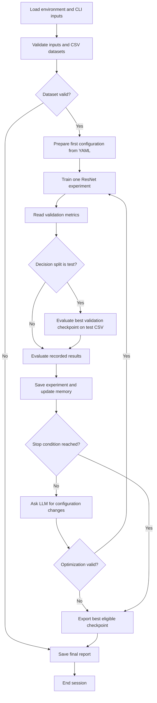

# ResNet Agent and Pipeline Documentation

## Contents

- [1. Purpose and terminology](#1-purpose-and-terminology)
- [2. Architecture and workflow](#2-architecture-and-workflow)
- [3. Environment and installation](#3-environment-and-installation)
- [4. Configuration and precedence](#4-configuration-and-precedence)
  - [4.1 Current YAML defaults](#41-current-yaml-defaults)
  - [4.2 Hosted LLM configuration](#42-hosted-llm-configuration)
- [5. Pipeline stages](#5-pipeline-stages)
- [6. What the LLM sees and can change](#6-what-the-llm-sees-and-can-change)
  - [6.1 LLM stages](#61-llm-stages)
  - [6.2 Prompt compaction](#62-prompt-compaction)
  - [6.3 Allowed changes](#63-allowed-changes)
  - [6.4 LLM opinions versus verified decisions](#64-llm-opinions-versus-verified-decisions)
- [7. Stopping rules and limits](#7-stopping-rules-and-limits)
- [8. Rate limits and error recovery](#8-rate-limits-and-error-recovery)
- [9. Experiment JSON](#9-experiment-json)
- [10. LLM response JSON](#10-llm-response-json)
- [11. Memory and historical evidence](#11-memory-and-historical-evidence)
- [12. Session summaries and final reports](#12-session-summaries-and-final-reports)
  - [`session_summary.md`](#session_summarymd)
- [13. Interruptions, standalone evaluation, and resume](#13-interruptions-standalone-evaluation-and-resume)
  - [Evaluating an existing checkpoint](#evaluating-an-existing-checkpoint)
  - [Resuming the standalone trainer](#resuming-the-standalone-trainer)
- [14. Code reference and verification](#14-code-reference-and-verification)

## 1. Purpose and terminology

The agent trains a multi-head ResNet classifier, measures its results, asks a hosted LLM to interpret those results and propose supported configuration changes, and repeats training until a stopping condition is reached. PyTorch performs training and inference locally. LangGraph coordinates the stages. The hosted LLM supplies analysis and configuration proposals.

| Term | Meaning in this project |
|---|---|
| Backbone | The shared ResNet feature extractor: `resnet18`, `resnet34`, or `resnet50`. |
| Head | A linear classifier for one CSV label column, such as `make`. |
| Epoch | One traversal of the training loader, followed by validation, within a single experiment. |
| Attempt / experiment | One training run with a selected architecture, pretrained checkpoint, and configuration. |
| Session | One agent invocation containing its sequence of experiments. |
| Checkpoint | A saved PyTorch model and its metadata. |
| Decision split | The split whose measured accuracy controls the target gate and best-experiment selection: `test` or `val`. |
| Target metric | `mean_acc` or one requested head's accuracy, such as `make_acc`. |
| LLM retry | Another API request for the same analysis after a temporary rate limit; it does not create an experiment. |

For example, `max_attempts: 40` and `epochs: 2` allow up to 40 experiments. The baseline experiment has a two-epoch limit; subsequent experiments can have different epoch limits after LLM tuning. Neither number represents the maximum number of API requests.

## 2. Architecture and workflow

The entry point is [main.py](../main.py). It loads `.env`, parses command-line arguments, checks the API key for a full run, and streams the compiled LangGraph state.



The graph in [agent/graph.py](../agent/graph.py) follows this sequence:

```text
user_input → dataset_validator → config_generator
→ trainer → monitor → test_checkpoint → evaluator → memory → decision
```

A continue decision runs `config_optimizer` and returns to `trainer`. A stop decision runs `onnx_exporter` and `reporter`. Invalid dataset inputs go directly to reporting. `--validate-only` runs the input and validation stages directly and exits without executing the full graph.

The first experiment uses the YAML training baseline before any LLM call. The first LLM evaluation happens after that experiment's measured results become available.

## 3. Environment and installation

Follow the [README installation steps](../README.md#installation) to create an environment and install `requirements.txt`, which pins the CUDA 12.4 PyTorch/Torchvision builds. Dataset paths, images, and pretrained weights must be supplied locally.

The main dependencies are:

| Dependency | Role |
|---|---|
| LangGraph | Pipeline state and conditional routing. |
| LangChain OpenAI client | Hosted chat-model requests through the configured API endpoint. |

The training script requires **CUDA and NCCL**, including a one-GPU run. Standalone checkpoint evaluation can use CPU, and `--validate-only` does not require a GPU or API key.

## 4. Configuration and precedence

### 4.1 Current YAML defaults

| Setting | Meaning |
|---|---|
| `decision_split` | `test` or `val`; controls the experiment score used for decisions. |
| `target_metric` | Mean head accuracy or a requested head's accuracy. |
| `target_value` | Accuracy fraction in `[0, 1]`; `0.99` means 99%. |
| `max_attempts` | Maximum total training experiments in one session. |
| `export_format` | `onnx` or `none`. |
| `nproc_per_node` | Number of CUDA/DDP training processes. |
| `epochs` | Maximum epochs for the baseline experiment. |
| `batch_size` | Training batch size per GPU. |
| `num_workers` | DataLoader workers per GPU. |
| `img_size` | Fixed resize dimensions `[height, width]`. |
| `lr`, `weight_decay` | AdamW learning rate and weight decay. |
| `gamma` | Focal-loss focusing exponent. |
| `patience` | Consecutive epochs without improved monitored validation accuracy before early stopping. |

The configuration generator overlays resolved inputs and generated values on the YAML baseline. In particular:

- Architecture, weights, CSVs, heads, GPU count, and optional loss inputs come from resolved user inputs.
- Checkpoint `monitor` is derived from the target: `mean_acc` uses `mean`; `make_acc` uses `make`.
- `out` becomes the allocated session directory under the project's `runs/resnet`.
- `name` becomes `exp_01`, then `exp_02`, and so on.
- Initial head loss weights come from `--head-loss-weights`, defaulting to `1.0` per head; optional alpha JSON comes from `--alpha-json`.

### 4.2 Hosted LLM configuration

Copy [`.env.example`](../.env.example) to `.env` and set your API key. The template matches the client defaults:

```ini
OPENAI_API_KEY=replace_with_your_api_key
OPENAI_MODEL=gpt-4o
LLM_TEMPERATURE=0.1
LLM_MAX_TOKENS=512
LLM_TIMEOUT_SECONDS=30
LLM_MAX_RETRIES=2
LLM_RATE_LIMIT_MAX_WAIT_SECONDS=60
```

For another OpenAI-compatible provider, set `OPENAI_API_BASE` to its API endpoint, put its key in `OPENAI_API_KEY`, and choose an `OPENAI_MODEL` available to your account. The template leaves the endpoint unset. This hosted configuration does not download an LLM locally.

| Variable | Code default if unset | Meaning |
|---|---|---|
| `OPENAI_MODEL` | `gpt-4o` | Model passed to the chat client; `.env.example` uses the same default. |
| `LLM_TEMPERATURE` | `0.1` | Sampling temperature. |
| `LLM_MAX_TOKENS` | `512` | Positive output-token cap for each request. It does not cap input prompt tokens. |
| `LLM_TIMEOUT_SECONDS` | `30` | Positive finite timeout configured on the client. |
| `LLM_MAX_RETRIES` | `2` | Additional requests allowed after transient HTTP 429 errors; zero disables them. |
| `LLM_RATE_LIMIT_MAX_WAIT_SECONDS` | `60` | Positive finite cumulative planned sleep budget for one LLM invocation. |

## 5. Pipeline stages

| Stage | Input and work | Main state/output updates |
|---|---|---|
| `user_input` | Resolve CLI, environment, YAML defaults, aliases, and optional prompts. | Split paths, heads, model selection, target, limit, loss inputs, input errors. |
| `dataset_validator` | Check inputs, CSVs, image paths, labels, and class mappings. | `validation_report`, normalized paths, `is_valid`. |
| `config_generator` | Build first configuration from YAML plus resolved inputs; allocate the session. | `current_config`, `session_dir`, initial config history and Markdown summary. |
| `trainer` | Validate full configuration and CUDA/NCCL availability; launch torchrun. | Incremented `attempt_number`, `training_result`, run folder, checkpoints. |
| `monitor` | Read training metric CSV; recover checkpoint-aligned validation results and histories. | `metrics` or a failure status. |
| `test_checkpoint` | In test mode, infer on all test rows using the best validation checkpoint. | Primary test metrics, separate validation snapshot, `test_result`. |
| `evaluator` | Ask LLM for diagnosis when usable results exist; apply deterministic corrections and target checks. | `evaluation_result`, issues, `target_reached`. |
| `memory` | Save experiment, verified score, completed comparisons, and session overview. | Experiment history, `best_experiment`, knowledge base, experiment JSON. |
| `decision` | Evaluate required test evidence, target, attempt limit, and instability. | `stop_reason`, confirmed target result. |
| `config_optimizer` | Request a proposal and validate supported hyperparameters/model choice. | Next configuration and rationale, or optimization error. |
| `onnx_exporter` | Export the session's eligible best checkpoint when requested. | ONNX path and metadata, or an export error. |
| `reporter` | Build factual reports and optionally append an LLM narrative. | Markdown report, report JSON, updated session summary. |

The shared [AgentState](../agent/state.py) carries these values. `config_history`, `experiment_history`, and `messages` use append reducers: node updates add new entries to the session state. `current_config` is the next/current training configuration; `best_experiment.config` remains the configuration of the winning experiment, even if later attempts use another architecture or image size.

The agent keeps live session state in memory. The graph is compiled without a persistent LangGraph checkpointer. Saved result files are experiment records, not an automatic whole-pipeline resume mechanism.

## 6. What the LLM sees and can change

### 6.1 LLM stages

| LLM use | Receives | Returns |
|---|---|---|
| Evaluation | Current measured metrics, configuration, decision split, target, and validation diagnostics. | Verdict, target proposal, issues, recommendations, reasoning. |
| Optimization | Current configuration/results, evaluation, compatible pretrained model catalog, and compact current-session experiment history. | `updated_config` and a brief `rationale`. |
| Final narrative | Session facts, best result/configuration, comparison rows, artifact paths, and errors. | Optional Markdown analysis appended to the factual report. |

These calls send serialized facts and metric summaries. Image pixels and model tensors are not included. The evaluator and optimizer do not receive the full CSV files or the complete saved training history as prompts. The provider key is used by the API client, not included as prompt context.

The graph uses direct chat requests for these stages. Decorated helper functions in `tools/` do not make this workflow an unrestricted LLM tool-execution loop.

### 6.2 Prompt compaction

[agent/llm_context.py](../agent/llm_context.py) keeps:

- Scalar metric values, measured scores, and relevant status/count evidence.
- The last five entries of loss and accuracy histories, with their original lengths.
- The last three current-session experiments, plus an older best verified experiment when needed.
- Up to three issue/recommendation items per summarized historical experiment.
- Up to 50 tested classes per head, selected by lowest accuracy when more classes are present.

Per-class tables contain class name, correct predictions, test count, and accuracy. They also state shown/total/omitted class counts and macro accuracy. Complete class results remain in `test_evaluation`. Classes omitted from a compact prompt do not imply zero accuracy. Test class counts do not establish training class frequencies.

### 6.3 Allowed changes

The optimizer can change up to **five changed hyperparameter keys** in one proposal:

| Key | Validation / meaning |
|---|---|
| `epochs` | Integer at least 1. |
| `batch_size` | Integer at least 1, per GPU. |
| `img_size` | Two integers at least 32: `[height, width]`. |
| `lr` | Positive finite number. |
| `weight_decay` | Finite nonnegative number. |
| `gamma` | Finite nonnegative number. |
| `patience` | Integer at least 1. |
| `head_loss_weights` | Requested heads only, finite nonnegative values, at least one positive value. |

An architecture/weights selection is separate from that five-key limit and must resolve to the compatible local catalog. A `head_loss_weights` dictionary counts as one hyperparameter key.

Dataset paths, head identity, class-alpha file, worker count, GPU count, checkpoint monitor, target settings, and output paths stay fixed during LLM optimization. Optimizer type, scheduler type, augmentation, and class-specific training parameters are not exposed as tunable proposal keys. Unrecognized proposal keys are not applied.

The next configuration is validated before training. More than five changed hyperparameters, invalid values, a non-dictionary `updated_config`, a non-string rationale, or an incompatible model selection cause an optimization error. An empty `updated_config` is currently accepted; there is no automatic rejection of an unchanged configuration.

### 6.4 LLM opinions versus verified decisions

The LLM proposes a diagnosis; code verifies the result. Its `target_reached` value is overwritten by the exact measured target check. A low score alone does not establish divergence: the code requires recorded nonfinite losses for that diagnosis. Recorded training/test failures also override incompatible LLM verdicts.

Changing configuration is the LLM's role. Gradient descent changes the actual model parameters. The LLM does not directly edit parameter tensors, pretrained files, or the baseline YAML.

## 7. Stopping rules and limits

The decision node checks these conditions in order:

| Priority | Condition | `stop_reason` |
|---|---|---|
| 1 | Required test evaluation is missing, failed, partial, or inconsistent. | `error` |
| 2 | Exact verified target metric meets or exceeds the target. | `target_reached` |
| 3 | Completed attempt number reaches `max_attempts`. | `max_attempts` |
| 4 | Successful monitored training has recorded nonfinite losses. | `unstable` |
| Otherwise | More attempts remain and no stop condition holds. | Empty string; proceed to optimization. |

Optimization failure independently sets `stop_reason: error` and routes to export/reporting. Errors such as export failures are included in the final report and affect CLI success.

Keep these limits distinct:

| Limit | Scope | Current baseline/default |
|---|---|---|
| `max_attempts` | Whole training session. | 40 experiments, unless overridden. |
| `LLM_MAX_RETRIES` | Additional requests for one LLM invocation. | 2. |
| `LLM_RATE_LIMIT_MAX_WAIT_SECONDS` | Planned sleep time across retries for one invocation. | 60 seconds. |

## 8. Rate limits and error recovery

The shared retry helper in [agent/llm_retry.py](../agent/llm_retry.py) retries actual transient HTTP **429** responses. The client SDK's own retry count is set to zero so retries are not multiplied at two layers.

The helper prefers `Retry-After` seconds or an HTTP date, then a millisecond header, a provider error-message delay such as `Please try again in 4.26s`, or a token-reset duration. Parsed provider delays get a one-second safety margin. Without a hint, the default two retries wait 5 and 10 seconds.

For example, the same optimization request may recover as follows:

```text
Requesting LLM optimization...
LLM rate limit reached; waiting 5.26s before retry 1/2.
<successful optimization rationale>
```

The same client and messages are reused. The attempt number does not increase while the API retry is waiting. Its response log remains pending until success, terminal error, or interruption.

The helper does not retry explicit daily/quota exhaustion, a request whose stated token requirement exceeds its limit, HTTP 413, authentication failures, arbitrary errors containing the text `429`, or malformed model output. Groq's zero remaining daily-request header is treated as exhausted quota only for responses from the Groq API host.

A provider delay exceeding the remaining waiting budget causes an immediate stop to retries; it is not shortened into an early retry. The wait budget covers scheduled sleeps, not the entire network runtime. Each request has its own configured timeout.

| Failure | Pipeline behavior |
|---|---|
| LLM evaluation unavailable after retries | Fall back to recorded metric-based diagnosis; measured target verification still runs. |
| LLM optimizer unavailable or invalid | Stop before another training attempt; export/report the eligible best result. |
| LLM final narrative unavailable | Save the deterministic factual report without the optional narrative. |
| Test inference failure | Stop test-mode decisions rather than substitute validation accuracy. |
| Training failure in validation decision mode | May proceed to tuning until the attempt limit; no failed score becomes a best result. |

See the provider's [Groq rate-limit documentation](https://console.groq.com/docs/rate-limits) for account-level limits and response headers. Provider quotas are external to `max_attempts`; an attempt limit does not reserve API capacity or guarantee that all attempts will run.

## 9. Experiment JSON

Each experiment's public JSON contains exactly these nine sections:

| Section | Contents |
|---|---|
| `experiment` | ID, recorded date, training status. |
| `objective` | Heads, target metric/value, checkpoint monitor. |
| `config` | Architecture, resource/epoch settings, grouped optimizer/loss/early-stopping fields. |
| `data` | Train, validation, and test CSV paths. |
| `training` | Completed epochs, best epoch, losses, full recorded histories. |
| `validation` | Selected checkpoint's validation mean and head accuracies/losses. |
| `test` | Test mean, total image count, head accuracies. |
| `evaluation` | Verdict, verified target result, issues, recommendations, reasoning. |
| `artifacts` | Experiment directory and best/last checkpoint paths. |

## 10. LLM response JSON

Each session has its own `llm_responses.json`. The supported structure is:

```json
{
  "session": {
    "session_id": "session_1",
    "model": "gpt-4o",
    "experiments": {
      "exp_01": {
        "attempt": 1,
        "stages": {
          "evaluation": {
            "status": "success",
            "response": {
              "verdict": "underfitting",
              "target_reached": false,
              "issues": ["Mean accuracy is below target"],
              "recommendations": ["Increase the training duration"],
              "reasoning": "The make head remains the weaker task."
            }
          },
          "optimization": {
            "status": "success",
            "response": {
              "updated_config": {
                "epochs": 30,
                "lr": 0.0003,
                "head_loss_weights": {"make": 2.0, "vehicle_type": 1.0}
              },
              "rationale": "Allow more epochs and give the weaker make head greater loss weight."
            }
          }
        }
      }
    }
  }
}
```

Only the session ID, model, experiments, attempt, stage status, and response are saved. Evaluation response dictionaries retain only `verdict`, `target_reached`, `issues`, `recommendations`, and `reasoning`. Optimization response dictionaries retain only `updated_config` and `rationale`.

| Status | Meaning |
|---|---|
| `pending` | The logical LLM invocation is running or waiting for a retry; response is `null`. |
| `success` | The provider returned a response. Configuration validation happens afterward. |
| `error` | The invocation ended with an exception; response is `null`. |
| `interrupted` | The invocation was cancelled with a keyboard interrupt; response is `null`. |

## 11. Memory and historical evidence

[memory/experiment_store.py](../memory/experiment_store.py) maintains `runs/resnet/knowledge_base.json` with three main collections:

| Collection | Role |
|---|---|
| `experiments` | Index of saved records, including a complete internal experiment record and a SHA-256 binding to its public JSON. |
| `best_configs` | Best recorded configuration by dataset/model/target context. |
| `lessons` | Completed before/after comparisons, changed configuration keys, measured scores, and whether the change improved results. |

Lessons are saved after the changed experiment completes and both comparable scores are available. An optimization proposal by itself is not recorded as an experimentally proven improvement.

Persistent comparison context includes architecture, target metric, resolved train/validation/test paths, ordered heads, and decision split. The current session's best selection can compare different architectures when the remaining task context is the same. This allows a stronger ResNet choice to replace an earlier model without mixing results from different tasks or test CSVs.

The baseline is always prepared from current YAML and user inputs. The config generator does not load a historical best configuration to replace that first attempt. The optimizer receives compact history from the current session; it does not automatically read all previous sessions or every saved lesson.

## 12. Session summaries and final reports

### `session_summary.md`

This deterministic Markdown overview is created when a session is allocated and updated after each saved experiment and at reporting/interruption. It includes:

- Session identity, heads, target, decision split, experiment count, status, and target-reached indicator.
- Experiment comparison with architecture, configured epochs, batch size, learning rate, loss weights, measured accuracies, verdict, and training status.
- Best experiment for the configured target, its configuration and best epoch.
- Best measured mean accuracy and best results for each head.

The comparison's `Epochs` column shows the configured limit, not necessarily the completed epochs. Incomplete/unverified results display `—`. Best-by-head rows may name different experiments; they are comparisons, not an automatically combined model.

When the target is a particular head, the target-winning experiment and mean-accuracy winner can differ. The summary identifies this difference. A `Completed` status means the session reached a normal stopping point, including its attempt limit; inspect `Target Reached` separately to determine whether the accuracy objective was met.

## 13. Interruptions, standalone evaluation, and resume

### Evaluating an existing checkpoint

```bash
python -m training.test_resnet \
  --gt_csv data/test.csv \
  --ckpt runs/resnet/session_1/exp_01/weights/best_model.pth \
  --data-root /datasets/compcars \
  --out_dir /path/to/separate_test_evaluation
```

The standalone evaluator also supports prediction CSVs and optional confidence thresholds. Thresholded evaluations can have partial coverage and are not equivalent to the agent's full-denominator target evaluation.

### Resuming the standalone trainer

The standalone trainer can restore `last_model.pth`, including optimizer, scheduler, epoch, and patience state. A representative command is:

```bash
python -m torch.distributed.run --standalone --nproc_per_node 1 \
  training/train_multihead_ddp.py \
  --train-csv data/train.csv \
  --val-csv data/val.csv \
  --data-root /datasets/compcars \
  --heads make vehicle_type \
  --arch resnet50 \
  --resume runs/resnet/session_1/exp_01/weights/last_model.pth \
  --epochs 30 \
  --batch-size 32 \
  --num-workers 4 \
  --img-size 224 224 \
  --lr 0.0001 \
  --weight-decay 0.0001 \
  --gamma 1.0 \
  --patience 10 \
  --monitor mean \
  --head-loss-weights make=1.0 vehicle_type=1.0
```

Use settings and dataset mappings consistent with that checkpoint, including any original alpha JSON. `--epochs` is the total desired final epoch, not the number of extra epochs. The restored scheduler state is retained; resume should not be assumed to create a new cosine schedule simply because the epoch argument changes.

Standalone resume continues the existing experiment folder and can append training metrics. It does not rerun the agent's test/memory/summary stages or automatically refresh previously saved experiment JSON, checksums, or reports. Use a new agent invocation for a new tuning session; the agent CLI has no whole-session resume option.

## 14. Code reference and verification

| File / directory | Responsibility |
|---|---|
| [main.py](../main.py) | CLI, environment loading, graph execution, exit handling, interruption summaries. |
| [agent/graph.py](../agent/graph.py) | Nodes, edges, and conditional routing. |
| [agent/state.py](../agent/state.py) | Shared state and accumulating histories. |
| [agent/nodes/user_input.py](../agent/nodes/user_input.py) | Input precedence, normalization, and prompts. |
| [agent/nodes/dataset_validator.py](../agent/nodes/dataset_validator.py) | Input, CSV, labels, mappings, and image-file checks. |
| [agent/nodes/config_generator.py](../agent/nodes/config_generator.py) | YAML baseline and session allocation. |
| [agent/nodes/trainer.py](../agent/nodes/trainer.py) | Validated torchrun launch and subprocess cleanup. |
| [agent/nodes/monitor.py](../agent/nodes/monitor.py) | Validation CSV parsing and best/final epoch diagnostics. |
| [agent/nodes/tester.py](../agent/nodes/tester.py) | Mandatory full-coverage test evaluation in test mode. |
| [agent/nodes/evaluator.py](../agent/nodes/evaluator.py) | LLM diagnosis, fallback, and deterministic target verification. |
| [agent/nodes/decision.py](../agent/nodes/decision.py) | Session stop rules. |
| [agent/nodes/config_optimizer.py](../agent/nodes/config_optimizer.py) | LLM proposal validation and model selection. |
| [agent/nodes/memory_node.py](../agent/nodes/memory_node.py) | Saving experiments, completed lessons, and current-session best result. |
| [agent/nodes/onnx_exporter.py](../agent/nodes/onnx_exporter.py) | Eligible best-checkpoint export. |
| [agent/nodes/reporter.py](../agent/nodes/reporter.py) | Factual final report and optional narrative. |
| [agent/llm.py](../agent/llm.py) | Hosted client construction and JSON parsing. |
| [agent/llm_retry.py](../agent/llm_retry.py) | Bounded transient-rate-limit recovery. |
| [agent/llm_context.py](../agent/llm_context.py) | Compact metrics, per-class tables, and experiment history. |
| [agent/llm_logging.py](../agent/llm_logging.py) | Atomic per-session LLM response writes. |
| [agent/session_log_format.py](../agent/session_log_format.py) | Strict LLM JSON projection. |
| [agent/session_summary.py](../agent/session_summary.py) | Deterministic Markdown comparison and best results. |
| [memory/experiment_format.py](../memory/experiment_format.py) | Public summary serialization and internal record normalization. |
| [memory/experiment_store.py](../memory/experiment_store.py) | Verified scores, historical loading, knowledge base, and lessons. |
| [memory/session_paths.py](../memory/session_paths.py) | Numbered session directory reservation. |
| [tools/config_tools.py](../tools/config_tools.py) | Allowed configuration keys and numeric validation. |
| [tools/pretrained_weights.py](../tools/pretrained_weights.py) | Compatible pretrained-model discovery. |
| [training/data.py](../training/data.py) | Shared CSV path and label adaptation. |
| [training/train_multihead_ddp.py](../training/train_multihead_ddp.py) | Model, focal loss, DDP training, checkpoints, and epoch early stopping. |
| [training/test_resnet.py](../training/test_resnet.py) | Inference, full-denominator scoring, class metrics, and confusion matrices. |
| [training/export.py](../training/export.py) | ONNX creation, checking, and metadata. |
| [training/artifact_paths.py](../training/artifact_paths.py) | Current layout and historical artifact path compatibility. |
| [tests/](../tests/) | Automated regression and integration verification. |
